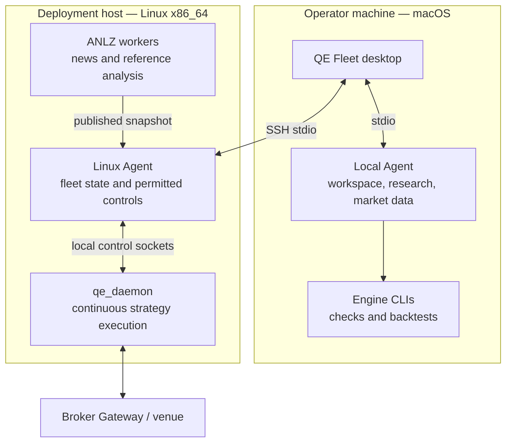
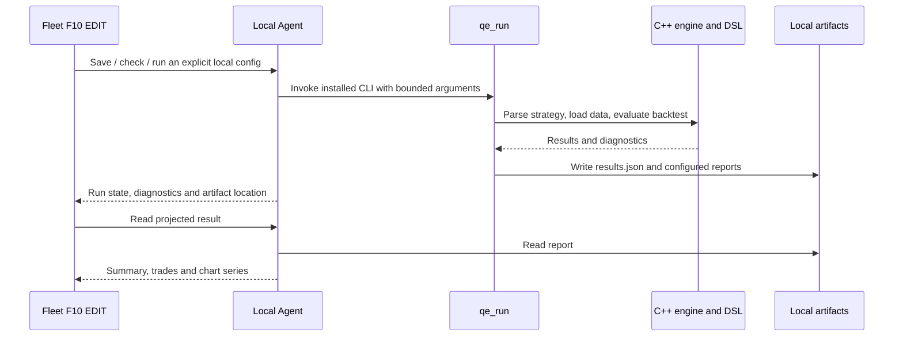
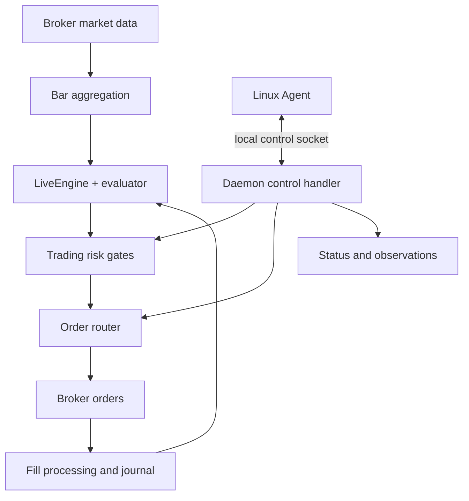
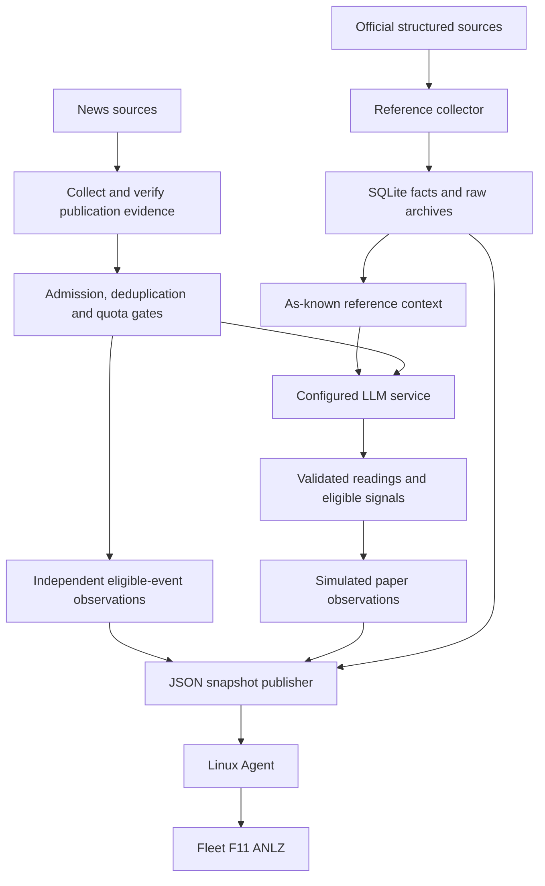

# Architecture

QE has two independent working environments: the operator's research machine
and the Linux host that runs trading strategies. QE Fleet connects them through
an Agent on each machine. The daemon owns continuous strategy execution; the
window can close without stopping it.

## System overview

Fleet does not link the C++ engine. Its Rust app backend starts Agent processes
and routes requests to them. The Agent uses the shared Rust `qe-fleet-core`
for projections, transport and operation policy. The C++ CLIs and daemon share
the C++ engine library; they run as separate executables.

## What ships

| Component | Responsibility | Distribution and lifecycle |
|---|---|---|
| **QE Fleet** | Desktop screens, editing and operator controls | Published macOS Apple Silicon application; Tauri shell with React UI |
| **Local Fleet Agent** | Local workspace, CLI invocation, public market data and cached projections | Bundled with Fleet; started and managed by the app |
| **Linux Fleet Agent** | Deployment-host observations, instance access and permitted server operations | Privately built and installed on the host; started through the Fleet SSH session; no public Linux Agent package |
| **Engine CLIs** | `qe_run` checks/backtests, `qe_factor` research, `qe_creds` credential administration | Published macOS Apple Silicon tools, installed independently of Fleet |
| **`qe_daemon`** | Continuous strategy evaluation, trading risk, broker orders and fill accounting | Linux x86_64 only; built and packaged natively on the target host with CPU-specific optimization; not publicly distributed |
| **ANLZ workers** | Collect and verify news, enrich context, run LLM analysis and maintain simulated observations | Independently supervised Python services on the deployment host; Fleet reads their published snapshot |

The daemon's build boundary is intentional: maximum performance takes priority
over a portable server binary. Target-host native compilation, including
`-march=native`, remains the deployment model. Neither the daemon nor the Linux
Agent has a public binary or container release pipeline. The macOS Agent stays
inside the Fleet application distribution. See [installation](install.md) and
[downloads](download.md) for supported artifacts.

## Two Agents, two sets of paths

Both Agents run the same program, `qe-fleet-agent`, with different roles.
The operation vocabulary assigns each request to the local machine, the fleet
host, or either machine about its own files. Routing is checked again by the
Agent: sending a workspace request to the fleet-only Agent is an error.

| Work | Local Agent | Linux / fleet Agent |
|---|---|---|
| Strategy authoring | Browse, read, save and check local `.qe` files | Receive an explicitly submitted strategy through the deployment operation |
| Backtests and factors | Invoke installed CLIs and track local runs | Read research artifacts available on the host |
| Market screens | Fetch quotes, charts, news and universe classifications; provide market-based risk inputs | Read daemon-side market and execution state as part of instance observations |
| Fleet monitoring | Supply local inputs to screens that combine both environments | Read manifest, comparison observations, instance state and logs |
| Trading controls | No direct venue-order path through local workspace operations | Execute supported cancel, kill and hot-config operations through configured daemon endpoints |
| F11 ANLZ | Rendered by the desktop UI | Read the analysis publisher's JSON snapshot and its worker states |

**A path belongs to the machine that reads it.** Workspace and CLI paths name
local files; manifest, daemon socket and analysis paths name host files. Research
artifacts can exist on either machine, so the selected source matters. A path
that exists on the Mac does not become a Linux path because it is entered in
Fleet's settings.

The app keeps a session connection to each Agent rather than opening SSH for
every poll. Requests and replies use length-prefixed JSON frames with IDs.
The handshake checks the protocol and the operations required for that role;
optional operations can remain unavailable without disabling unrelated screens.
Cached snapshots carry freshness and failure information. A remembered value
is not proof that the host is currently reachable.

## Backtest data flow (`qe_run` and the F10 EDIT path)

`qe_factor` uses the same strategy language and engine components to produce
factor reports. Research readers project the saved artifacts for Fleet rather
than shipping every raw per-bar array to the UI. Neither saving a strategy nor
running a backtest deploys it to a daemon.

Sharing the evaluator reduces implementation drift, but does not prove that a
backtest matches a live book. Data vintages, warmup, sizing, costs, broker fills
and account constraints must still be validated. See [factor research](factor-research.md),
[results schema](results-json.md) and [safety and limitations](safety-and-limitations.md).

## Live trading data flow (`qe_daemon` + a client attach)

The data, evaluation, risk and order path lives in the daemon, outside the UI
and both Agents. Fleet's market-screen quotes do not drive this execution loop.
The Linux Agent reads observations and sends the narrow control operations
that its configuration permits; it does not replace the daemon's trading risk
checks or broker adapter.

The daemon offers a full control socket and a separate read-only socket.
A read-only endpoint cannot perform writes. Fleet's remote Agent reaches these
sockets locally on the Linux host; SSH carries the Agent protocol between the
host and the desktop. A socket forward is a separate client option, not the
normal two-Agent path.

Operator actions include cancelling working orders, killing a strategy,
submitting a strategy file and applying supported hot-config changes. They are
separate operations: a successful file submission does not prove that a running
instance adopted it. The manifest, Agent role, window mode, configured control
endpoint and operation-specific gates constrain what is allowed. Paper and live
windows have separate process configurations; changing an IBKR client ID does
not create a separate account or isolate overlapping holdings.

Closing Fleet ends its Agent sessions. It does not stop independently supervised
daemons or ANLZ workers. Venue orders have their own lifecycle: disconnecting a
client or tripping the local kill switch does not imply that the broker cancelled
working orders. See the [runbook](live-trading-runbook.md),
[safety model](live-trading-safety.md) and [strategy comparisons](strategy-comparison.md).

## News and reference analysis (F11 ANLZ)

ANLZ is a separate Python pipeline, with collect, verify, analyze, quotes, paper
and reference workers. Its publisher exposes a bounded snapshot for Fleet;
there is no Python runtime embedded in the desktop application. The UI reads
worker states, readings, signals, reference values, source coverage and evaluation
records from that snapshot.

Reference observations preserve their observation period and the time the
pipeline first received that version. New analyses freeze their input context;
a later revision must not be treated as if it was known earlier. Reference
values and derived factors are background inputs, not validated trading signals.

Independent event-cohort observations are enrolled separately from LLM selection.
They and the LLM-selected paper ledger answer different evaluation questions;
their outcomes are not interchangeable. These are simulated observations in the
analysis pipeline, not orders in an IBKR paper account. There is no automatic
ANLZ-to-daemon live-order link.

## Cross-sectional fork-join barrier (EPIC-69)

Cross-sectional evaluation batches symbols at a common bar timestamp before
ranking them. The live engine records whether the batch completed with quorum
or was forced to flush after a timestamp change or timeout. A forced flush
can use incomplete coverage; the presence of a barrier is not a promise that
all symbols were fresh. See [safety and limitations](safety-and-limitations.md)
for the research and runtime consequences.

## Disconnect watchdog state machine (EPIC-70)

The watchdog observes broker connectivity, including the separate IBKR data
and order links. A soft pause can recover when connectivity returns; a kill
trip is sticky and requires the documented recovery procedure. The daemon
can keep processing data and fills while submissions are blocked. Working
venue orders are not automatically cancelled by a trip. Thresholds and operator
actions belong in the [live-trading safety model](live-trading-safety.md), rather
than a second set of constants on this overview page.

## On-disk layout

| Location | Owned data | Reader / writer |
|---|---|---|
| Operator workspace | `.qe` strategies, local run outputs and factor reports | Local Agent and installed CLIs |
| Fleet application data | Connection settings and cached observations, separated by window mode | Desktop application |
| Deployment-host fleet root | Manifest, per-instance definitions and collector observations | Host-side services; Linux Agent reads them |
| Per-instance runtime paths | Control socket, lock, journal, order state and logs | Daemon and its authorized host clients |
| Host data pool | Market datasets, analysis SQLite state, raw archives and analysis observations | Host collectors and ANLZ workers |
| Host/local credential stores | Credentials needed by the component on that machine | Native credential backend or configured protected environment |

Large persistent datasets and analysis archives belong on the deployment data
volume (`/datapool` in the current deployment), not the desktop system disk.
Sockets and other runtime files use the configured host paths. Exact installation
paths and overrides belong in [configuration and accounting](daemon-configuration.md)
and [installation](install.md).

Multiple instances require deliberate separation of their runtime and state
paths as well as broker/account policy. Distinct Agents, client IDs or journal
folders alone do not isolate an account's positions.

## Where to go next

- [Install and connect](install.md) — supported artifacts and host setup.
- [QE Fleet walkthrough](fleet-walkthrough.md) — screens, roles and controls.
- [First factor](first-factor-tutorial.md) — author and run a local strategy.
- [.qe language](qe-language.md) — strategy and execution configuration.
- [Factor research](factor-research.md) and [forecasting](forecasting.md).
- [Daemon runbook](live-trading-runbook.md) and [smoke checklist](qe-daemon-smoke.md).
- [Strategy comparisons](strategy-comparison.md) — instance and account boundaries.
